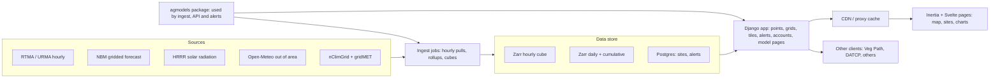

# AgWeather v2: feature inventory and rebuild plan

Oct 25, 2026 · @Ben

## Summary

The six apps share one core: a gridded weather store, a library of degree-day and disease models, and map/point/chart views on top. v2 should be one Python model library and one hourly-native data store inside one Django app, with Inertia + Svelte pages in the WISP 3 style, and forecast and Open-Meteo data flowing through the same model code.

- **The biggest win is hourly storage.** The old API reads 24 hourly RTMA grids, keeps only 2 m temperature and dew point, writes daily summaries, and deletes the GRIBs. Every model the Crop Risk Tool runs (tar spot, white mold, pecan scab, night-time RH hours, 30-day moving averages) cannot run on that daily table.
- **v2 stores the native 2.5 km NDFD grid that NBM, RTMA and URMA share** (decided 2026-10-25). Observations and forecast then line up cell for cell with no regridding. NOAA's URMA archive on AWS goes back to 2016-01-01, so the 11-year rolling window can be backfilled.
- **VDIFN's slowness is mostly the client, not the data.** It asks Rails, which asks the API, which runs a `GROUP BY` sum over about 19,500 points × N days in Postgres, then draws about 19,500 Google Maps `Rectangle` objects. Cumulative-sum cubes plus value-encoded map tiles colored on the GPU should take that from 5+ s to well under 0.5 s, even at 2.5 km.
- **Forecasts should be a first-class layer, not a bolt-on.** Today they come from three providers (OpenWeather, WeatherAPI, NWS) through per-point endpoints, and none of them feed models. NBM covers the native area. Open-Meteo covers everywhere and everything else: outside the area, before the rolling window, and as a fallback.
- **A lot can be dropped.** That includes AWON stations, HYD text reports, gnuplot/ImageMagick PNG maps, the three forecast vendors, static pest pages and commented-out models. See Drop candidates.

## Apps reviewed

| App | Stack | Role | Data in | Notable |
| --- | --- | --- | --- | --- |
| [AgWeather API](https://github.com/uwent/ag-weather) | Rails 8, Postgres, cron, gnuplot | Ingest, compute, serve | RTMA 2.5 km hourly (T, Td, precip), SSEC GOES insolation | 0.1° grid, lat 38–50, lng −98 to −82 (161 × 121 = 19,481 points); daily tables for weather, precip, insolation, ET, 17 DD models, 5 disease indices; PNG map generator; Swagger docs; data back to 2016 |
| [AgWeather site](https://github.com/uwent/soils-ag-wx) | Rails 8, ERB, jQuery | Public website and email service | AgWeather API, WeatherAPI, NWS HYD | Weather/precip/ET/insolation map + data pages, site dashboards, DD calculator, oak wilt, pest info pages, subscriber accounts with daily emails (weather, DD, forecast, oak wilt), HYD archive, DOY calendar |
| [VDIFN](https://github.com/uwent/ag-vdifn) | Rails 8 + Svelte 5, Vite, Tailwind, Google Maps | Map-based pest and disease risk | AgWeather API grids and points | 5 diseases and about 30 insects, filtered by 25 crops; severity 0–4 with biofix; custom DD model with gradient editor; point-detail popup; freeze-adjusted insect risk |
| [Crop Risk Tool](https://github.com/bzbradford/cpn-crop-risk-tool) | R Shiny, Leaflet, Plotly, mirai | Multi-site field and vegetable crop risk | Open-Meteo (paid tier), hourly history + 16-day forecast, \~9 km O1280 grid | Hourly-native pipeline (hourly → daily → night windows → moving averages → models); 16 disease/crop models, 3 insects; sites stored in cookies; CDL overlay; Google Places search; CSV import and export |
| [Alfalfa tool](https://github.com/bzbradford/alfalfa-tool) | R Shiny | Alfalfa growth and cut scheduling, climate | AgWeather whole-grid daily pulls, gridMET 5/10/30-year normals | Projected cut dates at 900–1100 GDD base 41°F; fall killing-freeze probabilities; weather vs climate charts |
| [Potato volunteer model](https://github.com/bzbradford/potato-volunteer-model) | R Shiny | Winter tuber survival risk | Wisconet hourly 2 in and 4 in soil temps | Hours below 27°F at two depths against a 120 h threshold; station map + air/soil charts |
| [WISP 3 (peer app, reference)](https://github.com/uwent/wisp3) | Rails 8.1 + Inertia + Svelte 5, Tailwind v4, MapLibre, ECharts, Solid Queue | Irrigation scheduling (checkbook water balance), rewritten in 2026 for the 2027 season | Open-Meteo only (observed, 16-day forecast, ensemble) per O1280 cell; no AgWeather dependency | Devise with magic links and 6-digit codes; daily digest emails; MapLibre map with radar/MRMS/Drought Monitor overlays and place search; ECharts with color-blind-safe tokens; WCAG AA tests; health checks and admin pages; AgWeather vs Open-Meteo comparison report |

The alfalfa tool downloads the whole AgWeather grid one day at a time into local files, which suggests v2 needs a bulk grid time-series export.

WISP 3 is not being rebuilt. It is the reference for v2's sign-in, email alerts, map engine, charts, layout and accessibility, and its weather comparison is useful evidence on source quality. It also removes AgWeather's largest outside consumer, and with it the main reason to keep the Diak ET method.

## Coalesced feature inventory

Verdicts: **Keep** = carry forward as is, **Rework** = keep the capability but rebuild it differently, **New** = on your wish list or implied by it, **Drop** = see the next section.

### Data sources and variables

| Feature | Where today | Verdict | v2 notes |
| --- | --- | --- | --- |
| Hourly 2 m temperature, dew point | API (RTMA, discarded after daily rollup) | Rework | Store hourly. Consider URMA (the QC'd RTMA, about 6 h later) for the archive and RTMA for the last few hours |
| Hourly RH, vapor pressure | API (derived) | Rework | Derive on read or at ingest |
| Wind speed, gust, direction; surface pressure; sky cover | Crop Risk (Open-Meteo); RTMA has them but API ignores them | New | Needed by white mold and other CPN models |
| Precipitation | API (RTMA pcp, daily sum) | Rework | Store hourly. Option: Stage IV / MRMS for better QPE |
| Solar insolation | API (SSEC GOES, daily) | Rework | Decided 2026-10-26: HRRR analysis downward shortwave (3 km, on AWS) regridded to the NDFD grid. SSEC's 0.1° product is a development cross-check only |
| Reference ET0 (FAO-56 Penman-Monteith, same method as Open-Meteo) | API | Rework | Decided 2026-10-26: compute hourly FAO-56 grass reference ET0 from temperature, humidity, wind, pressure and solar radiation, summed to daily, as Open-Meteo's `et0_fao_evapotranspiration` does. Native and Open-Meteo values then agree at the service-area edge. WISP 3 found NBM's ET0 within 0.003 in/day of AgWeather's (2025–26, 12 Wisconsin points) |
| Soil temperature and moisture | Crop Risk (Open-Meteo), Potato volunteer (Wisconet) | New | Decided 2026-10-26: modeled everywhere, no Wisconet dependency. HRRR land-surface soil temperature in the box (checked against Wisconet during development), Open-Meteo outside |
| Snow, snow depth | Crop Risk | Keep | Low priority |
| Climate normals (5/10/30-year) and frost/freeze probabilities | Alfalfa (gridMET), site frost maps (static) | Rework | 30-year normals from nClimGrid-daily or gridMET, recent normals from the 11-year archive. See Climate normals |
| Wisconet station data | Potato volunteer | Keep | Optional station layer and a development check on modeled soil temperature; not a dependency |
| Cropland Data Layer overlay | Crop Risk | Keep | Tile layer only |
| Gridded hourly forecast | None (point-only vendors) | New | Decided 2026-10-26: NBM in the box, Open-Meteo elsewhere (Professional plan, 5M calls a month) |

### Models

| Model | Where today | Verdict | v2 notes |
| --- | --- | --- | --- |
| Degree days, 17 fixed base/upper pairs, sine/average/modified | API, VDIFN, site | Rework | Cumulative cubes for fixed pairs; arbitrary base/upper computed on the fly |
| Late blight DSV (Wallin), early blight P-days | API daily, VDIFN, Crop Risk (hourly) | Rework | One hourly-native version; reproduce old outputs as a regression test |
| Carrot foliar DSV, Cercospora beet DIV, Botcast DSI | API, VDIFN, Crop Risk | Rework | Same |
| Tar spot, gray leaf spot, DON, white mold (dry/irrigated), frogeye, soybean Cercospora, red crown rot, wheat scab | Crop Risk | Keep | Port from R with test fixtures |
| Pecan scab, cotton planting, winter rye biomass | Crop Risk | Keep | Need out-of-area data (South) |
| \~30 insect DD models with risk arrays and freeze adjustment | VDIFN seeds | Keep | Move to declarative specs, like CPN's `Insect()` |
| Seedcorn maggot, alfalfa weevil, CPB generations | Crop Risk, VDIFN | Keep | Merge duplicates |
| Oak wilt vector flight risk (Jagemann 2018) | VDIFN, site, email | Keep |  |
| Alfalfa growth projection and cut scheduler | Alfalfa tool | Keep | Needs DD forecast + climate projection |
| Potato volunteer survival | Potato volunteer | Keep | Seasonal, Nov–Mar |
| Corn development stages (GDD from May 15) | Site static page | Rework | Becomes a model with stages, not a static table |
| Custom DD model with user gradient | VDIFN | Keep | Fast once DD is computed on the fly |

### API

| Capability | Where today | Verdict | v2 notes |
| --- | --- | --- | --- |
| Point time series (weather, precip, ET, insolation, DD, pest), JSON + CSV | API `index` endpoints | Rework | One `/points` family, hourly or daily, any variable list, multiple points per call |
| Whole grid for a date or range with sum/min/max/avg | API `grid` endpoints | Rework | Binary or PNG-encoded grids, plus GeoJSON/CSV for downloads |
| Map images | API `map` endpoints (gnuplot) | Rework | Tiles or data images |
| Multi-model DD table | API `dd_table` | Keep |  |
| Freeze-days grid | API `freeze_grid` | Keep | Generic "count of hours/days below X" |
| `vegpath` custom JSON for Vegetable Pathology site | API | Rework | Move Veg Path to the v2 endpoints; the old server keeps serving v1 through 2027 |
| Dataset health (`info`: date range, missing days) | API | Keep | Expose on an admin/status page |
| OpenAPI/Swagger docs | API (rswag) | Keep | Django Ninja generates it |
| Rate limiting, bot blocking | API, site (rack-attack) | Keep | At the proxy/CDN |
| Open-Meteo point fetch with caching | Crop Risk | Rework | Server-side cache keyed by grid cell, shared by all users |

### UI

| Feature | Where today | Verdict | v2 notes |
| --- | --- | --- | --- |
| Map explorer: variable, date or range, stat, units, palette | Site (images), VDIFN (rectangles), Alfalfa | Rework | One fast map, recolored in the browser |
| Crop → pest filter, severity legend, pest info and photos | VDIFN | Keep | Content in Markdown in the repo |
| Biofix / start-date picker | VDIFN | Keep |  |
| Grid-point details popup with recent table and averages | VDIFN | Keep |  |
| Multi-site list: map click, search, coordinates, CSV import/export | Crop Risk, site | Keep | Saved in local storage, synced when signed in |
| Site dashboard: last week of weather + DD | Site | Rework | Merge with Crop Risk risk feed |
| Risk feed per site with color-coded risk words | Crop Risk | Keep |  |
| Charts: hourly, daily, moving averages, GDD, weather vs climate, custom compare | Crop Risk, Alfalfa | Keep |  |
| Data download (hourly, daily, multi-site) | Crop Risk, site | Keep |  |
| Units toggle (metric/imperial) | All | Keep |  |
| Show my location, place search | Crop Risk, VDIFN | Keep | Swap Google Places for a free geocoder if cost matters |
| Forecast shown in charts and models | Crop Risk only | New | Everywhere, visually marked as forecast |
| Day-of-year calendar (100 years, today highlighted) | Site | Keep | Top page in Google Analytics. Restyle in the new frontend; keep its URL or redirect it so search traffic lands |

### Accounts, alerts, ops

| Feature | Where today | Verdict | v2 notes |
| --- | --- | --- | --- |
| Subscriber accounts by email token, saved sites | Site | Rework | Magic-link sign-in |
| Daily email digests (weather, DD, forecast, oak wilt) | Site | Rework | Decided 2026-10-26: keep a richer digest and add event alerts, with an alerts-only option. See Dashboard, feeds and email |
| Admin page, export subscribers | Site | Keep |  |
| Daily ingest at 6 AM with status email | API | Rework | Hourly ingest, health checks, alerting |
| Capistrano deploys to CALS VMs | All Rails apps | Rework | Docker Compose |
| Google Analytics | Shiny apps | Keep | Or a privacy-friendly option |

## Drop candidates

These are the items I would not carry forward. Each one is a guess from the code, so strike any you want to keep.

| Item | Where | Why drop |
| --- | --- | --- |
| AWON station tables, `stations` and `station_hourly_observations` | API (archived), site (commented routes) | Already deprecated; Wisconet replaced AWON |
| NWS HYD text-report archive and cron scraper | Site | Niche, text-only, and NWS publishes it already. A static archive could stay |
| gnuplot + ImageMagick PNG maps, image cache, purge job, pre-rendering in F/C × WI/all × stats | API | Replaced by in-browser coloring or tiles |
| OpenWeather 5-day, WeatherAPI 3-day, NWS hourly forecast endpoints | API, site emails | Replaced by one forecast layer that also feeds the models |
| WI-only `extent` option | API | The map can zoom instead |
| Static pest pages (alfalfa weevil, corn stalk borer, ECB, spongy moth, WBC, SCM) | Site | Merge into the model catalog's Markdown pages |
| Static first-frost maps | Site | Replaced by the climate module |
| CPB old model (dd\_52), BMSB, PVY endpoint, Botrytis PMI (Carisse) | VDIFN seeds, API (commented) | Unused or superseded |
| Both Diak/Priestley–Taylor ET formulas | API | Replaced by FAO-56 ET0, matching Open-Meteo and WISP 3 |
| `users` table, Active Storage | API | Unused |
| Google Maps (paid key) | VDIFN | MapLibre GL is free and faster for raster overlays |
| Server-side Shiny session caches (.fst per user) | Crop Risk | Replaced by a shared server cache |

## Proposed architecture

**Decided 2026-10-26: Django + Inertia + Svelte 5, all Python on the server.** One monorepo holds a shared Python model package, the data layer, and a Django app. The app serves the pages (through Inertia, as WISP 3 does with Rails), the accounts and alerts, and the public data API. The heavy work is array math (xarray, NumPy, Numba), so models, tiles and alerts all run in the same language and can call each other directly.

Ingest and the API import the same `agmodels` package, so a model gives the same answer on a map, in a chart, or over the forecast.

### Web layer: three options compared

Performance does not separate these options. The slow paths are tiles, grids, point series and model runs, and all three options serve those from Python (NumPy, Zarr, Numba) behind a cache. What differs is how many runtimes you maintain, how much of WISP 3 you can reuse, and how alerts reach model output. Every option already has two runtimes in production: SvelteKit's server is Node, just as Rails is Ruby.

|  | A. Rails/Inertia web + Python data service | B. FastAPI + SvelteKit | C. Django + Inertia + Svelte |
| --- | --- | --- | --- |
| Production runtimes | Ruby + Python (Node at build only) | Python + Node | Python only (Node at build only) |
| Hot-path performance | Same: browser fetches tiles and series straight from the Python service | Same | Same: numeric endpoints run in the same Python process, or a small FastAPI sidecar if needed |
| Page and form speed | Fast; Rails + YJIT is not a bottleneck at this traffic | Fast; SSR available | Fast; comparable to Rails |
| Reuse of WISP 3 | Highest: Devise + magic links, mailers, Solid Queue, health checks, Capistrano/systemd and Svelte pages copy almost directly | Svelte components only; Inertia pages become SvelteKit routes; auth and email rebuilt | Svelte pages port nearly as-is (same Inertia protocol); Ruby services re-written in Python but map one-to-one |
| Accounts and sign-in | Devise, proven in WISP 3 | Weakest: FastAPI has no built-in accounts, so you assemble a library or write your own | Django auth + django-allauth (supports login by email code) |
| Email alerts that need model output | Rails job calls the Python API per site, or Python sends the alerts itself; logic split across languages | Runs in-process with the models | Runs in-process with the models |
| Admin pages | Hand-built, as in WISP 3 | Hand-built | Django admin for free (users, sites, model metadata, ingest status) |
| Background jobs | Solid Queue for app jobs plus a separate Python scheduler for ingest | Python scheduler (APScheduler, arq or Celery) | One Python job system for ingest and app jobs |
| Types across the boundary | Typelizer for Rails pages + OpenAPI client for data calls | OpenAPI client end to end | Serializer types for pages + OpenAPI for the public API |
| Deploys and tests | Two apps, two CI suites, an internal API contract to version | One backend, one frontend | One app |
| Risk | Lowest to start; complexity grows at the Rails–Python seam | Most new code to write | New framework to learn, but Rails concepts transfer closely |

**Decision (2026-10-26): C, Django + Inertia + Svelte.** It gives one server language, models callable directly from alerts, and Django admin for free, and WISP 3's Svelte pages still carry over through Inertia.

### Monorepo layout

| Path | What it holds | Key tools |
| --- | --- | --- |
| `packages/agmodels` | Pure functions: hourly → daily → windows → DD → disease/insect models, each with its valid region. Same code runs on one point (pandas) or the whole grid (xarray) | NumPy, xarray, Numba where needed; parity tests against the R `.rds` fixtures and old API outputs |
| `packages/agdata` | Store access: hourly, daily, cumulative and climatology cubes; source adapters (URMA, RTMA, HRRR, NBM, Open-Meteo, nClimGrid, gridMET); tile encoding | Zarr v3, Herbie, cfgrib/eccodes, rio-tiler or a custom PNG encoder |
| `app/` (Django project) | Django apps: `accounts` (sign-in by link or code), `sites`, `alerts` (rules, digests), `catalog` (model metadata, regions, content pages, DOY calendar), `api` (public v2 API, tiles, points, grids), `ops` (ingest status, health) | Django, inertia-django, django-allauth, Django Ninja (OpenAPI + Pydantic), Django admin |
| `app/` jobs | Ingest (hourly pulls, rollups, cubes, backfill, yearly roll) and app jobs (alert checks, digests, health) in one Postgres-backed queue, like WISP 3's Solid Queue | Procrastinate (Postgres queue with periodic tasks) or Celery; management commands for the backfill CLI |
| `frontend/` | Svelte 5 pages and components served through Inertia: map explorer, sites and risk feed, charts, downloads, model pages. Ported from WISP 3 where they overlap | Svelte 5, @inertiajs/svelte, Vite, Tailwind v4, MapLibre GL with a WebGL data-tile layer, ECharts |
| `frontend/types` | TypeScript types for page props and API responses | Generated from the Ninja/Pydantic schemas via OpenAPI (openapi-typescript) |
| `infra/` | Docker Compose (or systemd units), Caddy/nginx, Postgres, backups |  |

Use uv for Python and pnpm for the frontend. Tile and point endpoints run as async Django views under an ASGI server (uvicorn or Granian). If Django's request overhead ever shows up in tile timings, a small Starlette app can be mounted under `/tiles` in the same process, sharing `agdata`.

Use uv workspaces for Python and pnpm for JS.

### Storage

- **Gridded weather lives in Zarr, not Postgres rows.** Use the native NDFD Lambert grid (2.5 km), cropped to the configured service box. Keep one Zarr store per year, so the rolling 11-year window drops a year by deleting one directory. The hourly cube (time × y × x × variable) is chunked for point reads, for example 30 days × 32 × 32 cells.
- **Daily and cumulative cubes are chunked for maps** (1 day × 256 × 256 cells), so a map tile reads one chunk per variable.
- **Cumulative cubes make range queries cheap.** For each fixed DD model and each additive index, store the running total since Jan 1. A sum over any date range is then `cum[end] − cum[start−1]`, one subtraction per cell.
- **The service box is configuration, not code.** Widening it means changing the bounds and running the backfill CLI for the new cells over the 11-year window.
- **Postgres stays for app data.** That covers users, sites, alert rules, ingest status, model region masks metadata and the Open-Meteo cache index.

### Maps: value-encoded data tiles

At 2.5 km the Upper Midwest box is about 909 × 740 cells and CONUS is 2,345 × 1,597, too large to send as one image. Serve **data tiles** instead: 256 px PNG tiles whose pixels encode values, not colors, cut from the daily and cumulative cubes. MapLibre colors them on the GPU, so palette changes, custom gradients and severity thresholds stay instant with no server round trip. Tiles for past dates never change and can be cached forever; today's are invalidated by the hourly ingest. A point click reads the value from the tile already on screen, then fetches the full time series.

### Forecast

- **Inside the service area:** NBM hourly to about 36 h and 3-hourly to about 11 days, on the RTMA grid, regridded to the same cells. HRRR is the alternative for 0–48 h with more detail.
- **Everywhere else, and as a fallback:** Open-Meteo, which you already pay for.
- **Stitching:** the archive ends at the last observed hour and the forecast starts at the next hour. Each value carries a `source` flag (obs / nbm / openmeteo) so charts can mark forecast periods and models can show "forecast-driven" risk.

### Service area and Open-Meteo blending

The native box starts as the Upper Midwest, about 35–50° N and 100–75° W (ND/SD/NE/KS to OH), with full CONUS as the goal if the server handles it. Open-Meteo fills three gaps: points outside the box, dates before the rolling window, and forecast when NBM is missing. Out-of-box requests snap to their O1280 cell, as the Crop Risk Tool already does, and are cached per cell for a few hours. Because the models consume a standard hourly frame, they do not care which source filled it, and every response carries a `source` field.

**Model regions.** Each model spec declares where it is valid, as a list of states or a polygon. At startup the region is rasterized to a mask on the grid. Outside its mask a model returns no value, the map greys that area out, and a point there shows "model not validated here" instead of a risk. This becomes essential at CONUS scale, for example to keep tar spot or pecan scab off maps where they don't occur.

### Climate normals

Use both sources, as the alfalfa app already does with its 5/10/30-year options. External data gives a true 30-year baseline. The internal archive gives recent normals on exactly the same grid as the observations.

| Baseline | Source | Coverage | Notes |
| --- | --- | --- | --- |
| 30-year (1991–2020 standard, or rolling) | [NOAA nClimGrid-daily](https://noaa-nclimgrid-daily-pds.s3.amazonaws.com/doc/nclimgrid-daily_v1-0-0_readme-web.txt) on AWS | CONUS, \~5 km, 1951–present, daily Tmax/Tmin/Tavg/precip | Free and public, no key. Enough for GDD, frost/freeze and precip normals |
| 30-year, more variables | gridMET (what the alfalfa app uses now) | CONUS, \~4 km, 1979–present | Included (decided 2026-10-25). Adds humidity, wind, solar radiation and reference ET normals |
| 5- and 10-year recent | Internal 11-year archive | Service box, native grid | Same grid and method as the observations, but the baseline moves as the window rolls |

Both are reduced once to **climatology cubes** on the native grid: a value per cell per day of year for each statistic. That covers mean, 10th/50th/90th percentile Tmin/Tmax, precip, cumulative GDD for the fixed models, frost (<32°F), hard freeze (<28°F) and killing freeze (<24°F) probabilities, and from gridMET, RH, wind, solar radiation and reference ET normals. Rebuild the external 30-year cubes when the normals period changes and the internal ones each January when the window rolls. Any point or map can then show this year against normal with no extra computation.

## Performance and storage budget

At the native 2.5 km grid, the Upper Midwest box needs roughly 500–600 GB for 11 years, so a 1 TB data volume covers it. Full CONUS needs about 3 TB. These are estimates assuming 10 hourly variables stored as scaled 16-bit integers with 3–4× compression. A one-month pilot should measure the real ratio before the volume is ordered.

| Extent | Grid cells (2.5 km) | Hourly / yr | Daily + cumulative / yr | 11-year total |
| --- | --- | --- | --- | --- |
| Current WI-centered box (38–50° N, 98–82° W) | \~299,000 | 13–18 GB | \~7 GB | 220–270 GB |
| Upper Midwest (35–50° N, 100–75° W) | \~673,000 | 30–40 GB | \~15 GB | 500–600 GB |
| CONUS (full NDFD grid) | \~3,745,000 | 165–225 GB | \~85 GB | 2.8–3.4 TB |

CONUS is likely lower than shown, because ocean, Canada and Mexico cells are empty and compress to almost nothing.

Climatology cubes, including the gridMET variables, add roughly 15 GB for the Upper Midwest (366 days × \~30 statistics) and 85 GB for CONUS, before compression.

### Backfill

I checked NOAA's archive on AWS ([noaa-urma-pds](https://noaa-urma-pds.s3.amazonaws.com/?list-type=2&delimiter=/&max-keys=5)). It has CONUS 2.5 km URMA analyses from 2016-01-01 to now, with temperature, dew point, wind, gust, pressure, visibility and cloud cover.

- **2016–2023 files have no byte-range index,** so each hour is a whole \~69 MB download. That comes to about 6–7 TB for 11 years, whatever the extent. It should be free from any AWS region and fastest from us-east-1.
- **Hourly precipitation (`pcp_01h`) starts around 2018–2019.** Decided: hourly precip starts in 2018. For 2016–2017 we keep only URMA's 6-hour totals, which are enough for weekly and seasonal sums.
- **Compute:** decoding about 96,000 hourly files is roughly one day on 16 cores (estimate). Run the backfill once on a temporarily larger instance, then drop back to the normal size.

After that, ingest is one hour at a time: a byte-range download of about 10 variables plus a crop, taking seconds even for CONUS.

### Latency targets

| Request | Today | v2 target | How |
| --- | --- | --- | --- |
| VDIFN-style risk map, any date range | 5+ s | < 300 ms to first view | Cumulative-cube subtraction into cached data tiles, colored on the GPU |
| Custom base/upper DD map, season to date | 25+ s (`compute=true`) | < 2 s Upper Midwest, then cached | Numba sine DD over \~673,000 cells × 365 days of daily min/max |
| Point season, hourly, all variables | Not available | < 300 ms | Time-chunked Zarr read |
| Point with forecast and all models | Crop Risk: several seconds per site | < 1 s | Shared forecast cache + models in-process |
| Palette or threshold change on the map | Full re-request | Instant | Done in the browser |

Put a CDN or reverse-proxy cache in front of the grid and tile endpoints. Past-date grids never change, so they can be cached forever. Today's grid is invalidated by the hourly ingest.

## Server requirements

Size the new Ubuntu 26.04 server for the Upper Midwest now. Growing to CONUS should then mean adding disk and RAM, not rebuilding. **The AWS region is open.** NOAA's Open Data buckets (URMA, RTMA, NBM, HRRR, nClimGrid) live in us-east-1. Because AWS sponsors them, reading them should cost nothing from any region. The current server's us-west-2 would work fine, with the only expected difference a somewhat slower one-time backfill (about 6–7 TB). Have IT confirm data transfer pricing for the chosen region.

**Give AgWeather v2 a dedicated server.** Its load is bursty (hourly ingest, multi-day backfills, a CONUS resize), and resizing an EC2 instance means a reboot. WISP 3 and other small apps fit better on a separate small server (WISP 3's own spec is 2 vCPU, 4 GB, 40 GB). That way neither app's maintenance or failures take the other down.

**RDS and Docker (IT's proposal, 2026-10-26).** Both fit. RDS holds the app data: users, sites, alerts, the job queue, ingest status and model metadata. That is only a few GB, so a small instance is enough. The gridded archive (hundreds of GB to TB) is Zarr files, not database rows, so it lives on an EBS volume attached to the server. EBS volumes can be enlarged without downtime, and older years can move to S3 later. Ask IT for the EC2 server, its EBS data volume, and RDS in the same region and availability zone, so database calls stay under a millisecond.

| Resource | Upper Midwest (now) | CONUS (goal) | Why |
| --- | --- | --- | --- |
| OS | Ubuntu 26.04 LTS, x86\_64 | Same | x86\_64 avoids arm64 build issues with eccodes and Numba |
| CPU / RAM | 8 vCPU, 32 GB minimum; 64 GB preferred (e.g. m7i.2xlarge or r7i.2xlarge) | 16 vCPU, 128 GB (e.g. r7i.4xlarge) | Season-to-date daily min/max for custom DD maps is \~2 GB in RAM for the Upper Midwest, \~11 GB for CONUS, plus workers and page cache |
| Data volume | 1 TB EBS gp3, throughput raised to 500 MB/s | 4 TB gp3, or 1 TB hot + S3 for older years | Zarr archive, one store per year |
| Root volume | 100 GB gp3 | Same | OS, Docker images, logs |
| Scratch | 200 GB (instance store or gp3) | Same | GRIB downloads, deleted after decode |
| Backfill burst | Temporarily resize to 16–32 vCPU for 1–2 days | Same, longer | One-time 11-year backfill and any area expansion |
| Backups | RDS automated backups with point-in-time restore for Postgres; weekly EBS snapshots of the Zarr volume | Same | The Zarr archive can be rebuilt from NOAA, but that takes days |
| Inbound | 443 (and 80 for redirect), SSH from campus | Same |  |
| Outbound | 443 to AWS S3, nomads.ncep.noaa.gov, Open-Meteo customer API, SSEC and Wisconet (development checks only), email relay | Same |  |

### Software on the host

- Docker Engine and Compose v2, or systemd units as in WISP 3. Services: `web` (Django on uvicorn or Granian, Python 3.13), `worker` (job queue: ingest, alerts, digests), Caddy or nginx for TLS, all in Docker. Postgres runs on Amazon RDS (IT's suggestion), in the same region and VPC as the server. Node 24 at build time only, for Vite.
- systemd timers, or a scheduler container, for hourly ingest, daily rollups and the yearly window roll.
- Monitoring with the CloudWatch agent or Prometheus node exporter, an external uptime check, and alerts when ingest falls behind.
- unattended-upgrades for security patches.
- An IAM instance role with write access to the backup bucket. The NOAA buckets are public and need no credentials.
- A DNS name, and a decision on whether v2 replaces agweather.cals.wisc.edu or runs beside it during migration.

## Launch priorities

P0 is needed for the 2027 season launch. P1 comes during the 2027 season. P2 waits for the refinement period after it. This is my first sort; reorder freely.

| Feature | Priority | Why |
| --- | --- | --- |
| Hourly archive, backfill, daily and cumulative cubes (Upper Midwest) | P0 | Everything else reads it |
| NBM forecast, Open-Meteo outside the box and before the window | P0 | Forecast is required for v2 |
| Degree days by API for Veg Path and DATCP's daily GDD query | P0 | Outside callers depend on them from spring |
| Point weather and ET0 (FAO-56) API with OpenAPI docs | P0 | Farms and Ben's apps pull it |
| Map explorer with data tiles: weather, DD, gridded risk maps | P0 | VDIFN successor |
| Sites dashboard and both feed views | P0 | Crop Risk successor |
| Disease and insect models from Crop Risk, VDIFN and the API, each with citations, version and status | P0 | The core of the app; references are part of each model from day one |
| Daily digest, event alerts, alerts-only option, announcement to current subscribers | P0 | Subscribers expect email in season |
| Changelog and announcements page, service-update opt-in, "how do you use the API" form | P0 | Must exist before endpoints change |
| Day-of-year calendar | P0 | Top page in Google Analytics, and small |
| Model about pages with generated prediction sweeps | P1 | Text and citations ship at launch; sweeps follow |
| Alfalfa module (growth projection, cut scheduler) | P1 | First cut is late May |
| Potato volunteer module | P1 | Uses winter soil temperature; needed by next fall |
| Climate normals and current-vs-normal comparisons | P1 | Feeds the digest's season context |
| Downloads: hourly, daily, multi-site CSV | P1 |  |
| Glossary and notes from WISP 3 | P1 |  |
| Frost and freeze probabilities | P2 | Replaces static frost maps |
| Personal API keys | P2 | Only if usage gets out of hand |
| CONUS expansion | P2 | After a season of running costs |

## Models: transparency and versioning

- **Readable and open.** One Python file per model in `agmodels`, with plain names, units in the code and a docstring saying what it predicts. The repo is public.
- **References for every model.** Each definition carries its citations: published papers, or a named attribution for unpublished work. They show on the model's about page and in API metadata.
- **Generated about pages.** Each model declares a sweep, a set of input conditions such as temperature by hours of leaf wetness. A build step runs the model across it and renders charts and tables, as CPN's smoke tests do. The same sweeps run as regression tests, so a change to a model shows on its page and fails CI if it was not intended.
- **Versions and status.** Each model has a version and a status: beta (under development; hidden until a user turns on beta models in settings, as in the CPN tool, then shown with a beta or provisional badge), stable, or retired. API responses name the model and version that produced them. A per-model changelog records new data, retraining or method changes.
- **Retraining.** Fitted models such as CPN's logistic models keep their coefficients in a versioned data file beside the code, with the training source noted. Retraining makes a new version, and the old one stays runnable for comparison.
- **Regions and seasons.** Each model declares its valid area (states, geofence or shapefile) and season window. These decide where maps show it and when the digest includes it.
- **Days and nights.** Data is stored in UTC and shown in local time. A model can define its day as the local calendar day, or define day and night by civil sunrise/sunset or solar noon/midnight, computed per grid cell.

## Public API: consumers and announcements

- **Known callers.** Ben's apps including Vegetable Pathology; WI DATCP's daily GDD query for its insect models, needed from the 2027 season (Ben will send them the new endpoints); and possibly a few farms pulling ET. Others are unknown.
- **No v1 shim (decided 2026-10-26).** Callers must change their config for the new URL anyway, so v2 skips the shim. The v1 URLs redirect to the old production server, which keeps the legacy API running through the 2027 season; its access logs show who still calls it. DATCP updates quickly and has lost GDD days to import errors in the old API, so a more reliable feed is welcome.
- **Changelog and announcements.** A page on the site, also linked from the API docs, for endpoint changes, new models and outages.
- **Service-update emails.** An opt-in in each user's alert settings.
- **"Tell us how you use the API."** A short form linked from the docs and changelog, saved for review in Django admin.
- **No API keys at launch.** Rate limits sit at the proxy. If usage gets out of hand, add a simple sign-up for a free personal key: unlimited, but useful for tracking.

## Dashboard, feeds and email

- **Sites dashboard.** Save several sites (in the browser, synced when signed in). Each shows recent weather, forecast and the status of its models.
- **Map view.** Gridded risk maps for every model, beside the weather layers.
- **Feeds.** Two views: one model across all your sites, and one site across all models.
- **Daily digest.** Today it has 7 days of past weather and a 3-day forecast. v2 adds the extended forecast, season-to-date context against normal (DD, precip), the in-season models for each site, and upcoming thresholds.
- **Event alerts.** Sent when a threshold is crossed or forecast to be, such as "DSV passes 18" or "frost tonight". Users choose the digest, alerts only, or both.
- **Scale.** Subscribers number in the low 100s, so one worker job and an email relay or Amazon SES is plenty.

## Phased build plan

Build data first, then the API, then the UI, aiming to launch before the 2027 growing season (target April 1, 2027). The months are my estimate for Ben and Claude working alone; WISP 3 took about a month, and this is several times its size. Run the old stack in parallel until v2 matches its outputs. Each phase ends with a gate.

1. **Foundations (November 2026).** Start the repo by copying WISP 3's CLAUDE.md and keeping the notes that apply (conventions, Inertia + Svelte patterns, front-end polish, deploy). Monorepo skeleton, CI, Docker Compose, NDFD grid with a configurable service box, Zarr layout (one store per year), and a variable catalog with units. Run a one-month pilot to measure compression and settle the volume size.
   - Gate: server requirements confirmed with IT.
2. **Hourly archive (November–December).** URMA via Herbie, RTMA for the last few hours, HRRR shortwave and soil temperature regridded to the NDFD grid. QC and gap-fill. A backfill CLI for any box over the 11-year window, and a yearly job that drops the oldest year. Daily rollups by each cell's local calendar day, solar day/night windows, cumulative cubes, and climatology cubes (nClimGrid-daily and gridMET 30-year, archive recent years).
   - Gate: v2 daily min/max/DD/precip agree with the old API within tolerance across 2016–present; ET0 checked against Open-Meteo and SSEC.
3. **Model library (December–January).** Port the VDIFN/API daily models and the CPN R models to `agmodels`, hourly-native where they exist. Every model has one readable file, citations, a version and status, a valid region, and a sweep spec for its about page.
   - Gate: parity tests pass against the R fixtures and old API outputs.
4. **Forecast and Open-Meteo blending (January).** NBM ingest on the same grid, obs + forecast stitching with source flags, models run through the forecast window. Open-Meteo for points outside the box and before the window, cached by cell.
5. **API v2 (January–February).** Points, data tiles, grids, models, downloads, OpenAPI docs, the changelog page. Veg Path and DATCP move to the v2 endpoints.
   - Gate: v2 GDD matches the old API for DATCP's query; DATCP has the new endpoints before the season.
6. **Web app (February–March).** Map explorer with gridded risk maps, sites dashboard and both feed views, charts and downloads, model about pages, alfalfa and potato volunteer modules, DOY calendar, and WISP 3's citations, notes and glossary.
   - Gate: beta users on the new site.
7. **Accounts and email (March).** Sign-in, synced sites, daily digest, event alerts, alerts-only option, service-update opt-in, and a BCC announcement asking current subscribers to sign up on the new site.
8. **Launch (by April 1, 2027).** VDIFN and soils-ag-wx redirect to v2, and the soils-ag-wx emails stop. v1 API URLs redirect to the old production server, which keeps the legacy API running through the 2027 season and then retires.
9. **Refinement and CONUS (2027 season onward).** P1 and P2 features, new models and versions. Then widen the box, run the backfill, resize the server, and tighten model region masks.

## Open questions for Ben

Most were answered on 2026-10-25 and 2026-10-26. Server sizing is with IT. Everything else is answered.

- [x] **Grid resolution.** Native NBM/NDFD 2.5 km grid, no downsampling.
- [x] **History depth.** Rolling 11 years, 2016–2026 to start, dropping the oldest year each January. Open-Meteo covers dates before the window.
- [x] **Expansion target.** Upper Midwest (about 35–50° N, 100–75° W) now, with a configurable box and backfill scripts. Full CONUS is the goal if the server handles it, with per-model geographic regions.
- [x] **Hosting.** A fresh university-provided AWS server on Ubuntu 26.04, not ready yet. Requirements are in Server requirements.
- [x] **2016–2017 precipitation.** Hourly precip starts in 2018; older years keep 6-hour totals.
- [x] **Model regions.** Each model definition declares its area as a list of states, a geofence (bounding box or polygon), or a shapefile.
- [x] **Climate.** 30-year normals from an external source, plus recent normals from the 11-year archive.
- [ ] **Server size, region and pricing.** Ben to discuss with IT. Any region works; the minimum and CONUS sizes are in Server requirements.
- [x] **30-year source.** Both: nClimGrid-daily for temperature and precip, plus gridMET for humidity, wind, solar and ET normals.
- [x] **Solar radiation for ET0.** HRRR analysis shortwave, regridded, in production. SSEC's 0.1° plain-text product is a development cross-check only, not a dependency.
- [x] **Web app stack.** Django + Inertia + Svelte 5 (option C), decided 2026-10-26.
- [x] **Outside consumers.** Ben's apps including Vegetable Pathology, WI DATCP's daily GDD query (matters from the 2027 season; Ben will tell them the new endpoints), and possibly a few farms pulling ET. See Public API.
- [x] **Forecast source.** NBM in the box, Open-Meteo elsewhere. Ben's Open-Meteo API Professional plan allows 5 million calls a month and includes historical and climate data.
- [x] **Shiny apps.** All three are absorbed into the new app: multi-site dashboard, map view with gridded risk maps, and both feed views (one model across sites, one site across models).
- [x] **Soil temperature.** Modeled everywhere, with no Wisconet dependency.
- [x] **Accounts and email.** Low 100s of subscribers. Keep a richer daily digest and add event alerts, with an alerts-only option. See Dashboard, feeds and email.
- [x] **Day definitions.** Store UTC, display local time. Some disease models define day and night by civil sunrise/sunset or solar noon/midnight.
- [x] **Team and timeline.** Ben and Claude, with campus IT for infrastructure. Ready for the 2027 growing season, then a long refinement period.
- [x] **Model ownership.** Readable, open source, cited, versioned (including beta), with generated about pages. See Models: transparency and versioning.
- [x] **Beta models.** Hidden by default. A settings option shows them with a beta or provisional badge, as in the CPN tool.
- [x] **Subscriber migration.** A BCC email to current subscribers announces the new site and asks them to sign up there.
- [x] **v1 API.** No shim in v2. v1 URLs redirect to the old production server, which runs the legacy API through 2027 and then retires.
